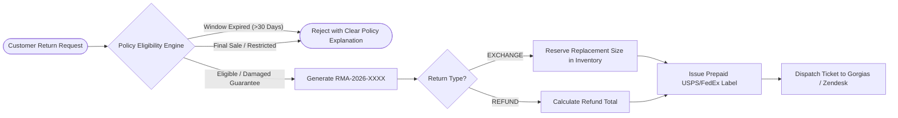

# 🛡️ Autonomous E-Commerce Returns & Exchanges Engine

[](https://python.org)
[](https://shopify.dev)
[](https://gorgias.com)
[](tests/test_returns.py)
[](LICENSE)

> **Zero-touch Return Merchandise Authorization (RMA), instant prepaid label generation, and automated inventory exchange engine for Shopify brands.** Engineered by **[SYMIDIC](https://www.symidic.xyz)**.

---

## ⚡ Overview

Handling returns and size exchanges manually drains 15-25 hours per week for e-commerce brands. This engine provides an **autonomous RMA pipeline** that:
1. **Validates Eligibility Instantly:** Evaluates 30-day windows, non-refundable tags (`final_sale`, `clearance`), and condition criteria.
2. **Instant Prepaid Labels:** Auto-generates trackable return labels with unique RMA IDs.
3. **Automated Exchanges:** Reserves alternative sizes/colors in inventory to preserve the sale instead of defaulting to a cash refund.
4. **Bi-Directional Helpdesk Sync:** Automatically logs tickets and status updates into Gorgias, Zendesk, or Shopify Plus.

---

## 🏗️ RMA Workflow Flowchart



---

## 🚀 Quickstart & Tests

### 1. Clone the Repository
```bash
git clone https://github.com/abdulrehman-symidic/ecommerce-returns-automation.git
cd ecommerce-returns-automation
```

### 2. Run Automated Unit Tests (100% Pass)
```bash
python -m unittest tests/test_returns.py
```

---

## 🧪 Python Usage Example

```python
from datetime import datetime, timedelta
from returns_engine.rma_engine import RMAEngine

engine = RMAEngine()

# Initiate an automated size exchange
result = engine.create_return_request(
    order_number="SHP-9481",
    customer_email="customer@example.com",
    item_id="item_01",
    item_name="Merino Wool Cyber Hoodie",
    item_price=128.00,
    purchase_date=datetime.now() - timedelta(days=4),
    tags=["apparel", "hoodies"],
    return_type="EXCHANGE",
    desired_exchange_size="L"
)

print(result)
```

**Output:**
```json
{
  "rma_number": "RMA-2026-F981AC",
  "status": "APPROVED",
  "order_number": "SHP-9481",
  "return_type": "EXCHANGE",
  "desired_exchange_size": "L",
  "prepaid_label_url": "https://shipping.symidic.xyz/labels/RMA-2026-F981AC.pdf",
  "carrier": "USPS Priority Return",
  "estimated_refund": 0.0,
  "reason": "Item is fully eligible for return or size exchange."
}
```

---

## 👨‍💻 Author & License
Architected by **Abdul Rehman** — Founder & Lead AI Systems Architect at **[SYMIDIC](https://www.symidic.xyz)**.  
Licensed under the [MIT License](LICENSE).
